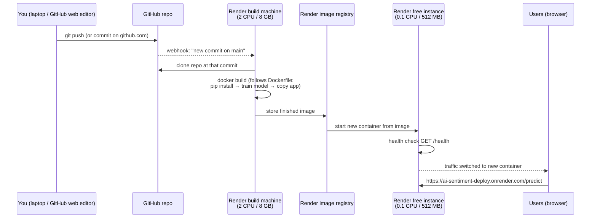

GitHub stores your code. Render watches GitHub, builds a Docker image from your code, and runs that image as a container behind a public URL. You don't need Docker on your laptop because Render does the building.

## The pieces

| Piece | Role | Analogy |
|---|---|---|
| **GitHub** | Stores your code, the Dockerfile and the data, and keeps every past version | The recipe book |
| **Dockerfile** | Step-by-step instructions for building the image | One recipe |
| **Docker image** | The packaged result: Linux, Python, libraries, your code and the trained model, all frozen together | A sealed ready-meal |
| **Container** | A running copy of the image | The meal being served |
| **Render** | Builds the image, stores it, runs it, and gives it a URL with HTTPS | Kitchen, warehouse and restaurant in one |

## What happens on each `git push`

1. **GitHub tells Render.** When you connected the repo, Render installed a GitHub App that pings Render on every commit to `main`. This is "Auto-Deploy: On Commit".
2. **Render builds the image** on a separate, larger build machine (2 CPU / 8 GB), working through your `Dockerfile` top to bottom. These are the lines you see in the **Events → Build logs** tab: `pip install`, then training prints its accuracy, then `Saved model v2.0.0`.
   - Render remembers the result of each step. If only `app/main.py` changed, it reuses the saved install and training steps, which is why the redeploy is quick.
3. **Render stores the image** in its own private image store. You never touch it, but it's why **Rollback** works: Render keeps your last couple of images and can restart one.
4. **Render starts a container** from that image on your free instance.
   - It sets the `PORT` environment variable to 10000, and the Dockerfile's `CMD` starts the web server on that port.
   - The **Logs** tab shows the container's live output: `Loaded model`, then `predict sentiment=...`.
5. **Render checks health before switching traffic.** It calls `/health`, and only when that returns 200 does it send traffic to the new container and stop the old one. That's a zero-downtime deploy. If the check fails, the old version keeps running and the deploy is marked failed.
6. **Users connect through Render's front door.** `https://ai-sentiment-deploy.onrender.com` goes to Render's proxy, which handles HTTPS and forwards each request to your container on port 10000.

## Render behaviours that are new if you've never used it

- **Building and running happen on different machines.** That's why training can use about 520 MB at build time while the running app has only 512 MB.
- **The free instance sleeps.** After 15 minutes without traffic Render stops the container. The next visitor sees a loading page for about a minute while Render starts a fresh container from the same image. Nothing is lost because the model lives in the image.
- **Files written while the app runs are lost** whenever the container restarts or redeploys. Anything that must survive has to go in a database or other storage. This app doesn't need any.
- **Settings live in two places.** Your repo holds the Dockerfile and `render.yaml`. The Render dashboard holds the instance type, region, environment variables and secrets. Secrets go in the dashboard, never in the repo.
- **Manual controls** are in the top-right **Manual Deploy** menu: "Deploy latest commit" rebuilds without a new push, and "Clear build cache & deploy" forces every step to rebuild.

## Where to look in the Render dashboard

| Tab | What it shows |
|---|---|
| **Events** | Every deploy: what triggered it (which commit), its build log, and whether it succeeded |
| **Logs** | The running container's live output |
| **Settings** | Repo and branch, Docker as the language, Dockerfile path, health check path, Auto-Deploy, instance type |
| **Metrics** | CPU and memory use, which is handy for showing the room "185 MB of 512 MB" |

**One sentence for your audience:** *"GitHub holds the recipe, Render cooks it into a sealed package on a big machine, then serves that package from a small machine, and every time we change the recipe, it automatically cooks and serves a fresh one."*